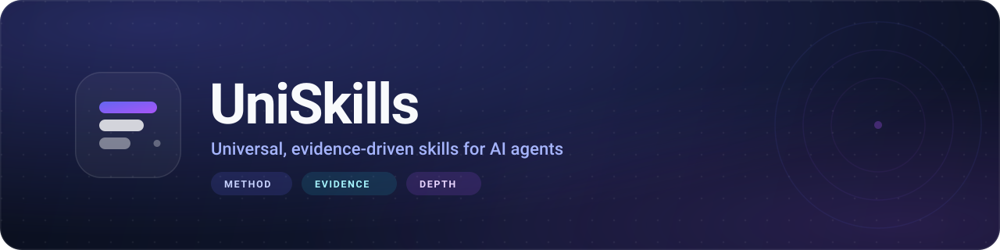
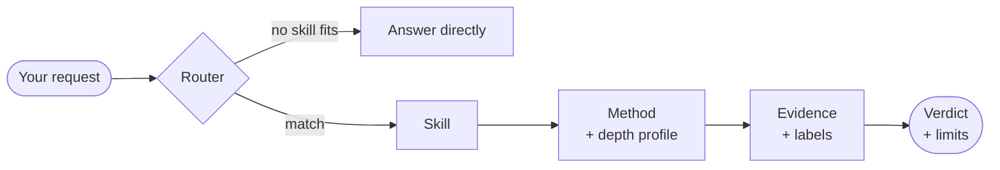

<div align="center">



<br>

<a href="https://github.com/alfanowski/UniSkills/actions/workflows/validate.yml"></a>
<a href="https://github.com/alfanowski/UniSkills/releases"></a>
<a href="LICENSE"></a>
<a href=".github/workflows/validate.yml"></a>
<a href="https://agentskills.io/specification"></a>

<sub>12 skills · 6 packs · 36 evaluation cases · 0 dependencies</sub>

</div>

---

### Stop pasting prompts. Start running procedures.

Prompts are excellent at producing text and terrible at guaranteeing a method. UniSkills is a set of
installable skills that carry their own workflow, evidence rules, and stop conditions — so a code review
looks the same on a quiet Monday and on the night before a release.

| 🎯 **Evidence, not vibes** | 🧭 **Depth that fits the risk** | 🧱 **One folder, zero dependencies** |
| :-- | :-- | :-- |
| Every load-bearing claim is labeled and pointed at. "Verified" means someone can check it. | `QUICK` for a typo, `FORENSIC` for an incident. Risk picks the depth, not diff size. | Copy the directory. No runtime, no installer, no account. Uninstall is `rm -rf`. |

## ⚡ Install in ten seconds

```bash
git clone https://github.com/alfanowski/UniSkills.git
cp -R UniSkills/skills/universal-code-review ~/.claude/skills/
```

Then ask it something it was built for:

> **"Review this diff and tell me whether it is safe to merge."**

That is the whole setup. Point the copy at whatever skills directory your client uses; everything the
skill needs is inside that folder. Full instructions, uninstall, and troubleshooting:
[`docs/installation.md`](docs/installation.md).

<details>
<summary><b>Install a pack, or verify the repository locally</b></summary>

<br>

A pack is an ordered playbook over skills you install individually:

```bash
cp -R UniSkills/skills/{root-cause-debugging,universal-code-review} ~/.claude/skills/
cat UniSkills/packs/debugging-and-regression.md
```

Everything is checkable offline with a bare Python 3 interpreter:

```bash
cd UniSkills
python3 tools/validate_skills.py      # structure, contract, links, evals
python3 tools/validate_catalog.py     # catalog ↔ filesystem ↔ packs
python3 tools/check_links.py
python3 tools/check_secrets.py
python3 tools/render_catalog.py --check
python3 tools/eval_runner.py --check
python3 -m unittest discover -s tools/tests -t .
```

</details>

## 🧠 What happens when you ask



The router picks the capability and the budget. The skill supplies the procedure. The evidence rules keep
the answer checkable. Nothing in the chain is a persona.

## 🧰 The skills

Twelve skills. Each one is a complete workflow, two on-demand references, and three evaluation cases.

**Core**

- [`uniskills-router`](skills/uniskills-router/SKILL.md) — picks the skill, the depth, and the deliverable.
- [`context-efficiency`](skills/context-efficiency/SKILL.md) — spends context without losing evidence.
- [`evidence-validation`](skills/evidence-validation/SKILL.md) — decides whether a claim is actually supported.

**Engineering**

- [`universal-code-review`](skills/universal-code-review/SKILL.md) — decides whether a change is safe to merge.
- [`root-cause-debugging`](skills/root-cause-debugging/SKILL.md) — finds the cause, not the symptom.
- [`architecture-design-review`](skills/architecture-design-review/SKILL.md) — commits to a structure, with a migration path.
- [`performance-review`](skills/performance-review/SKILL.md) — separates measured cost from estimated cost.

**Security and systems**

- [`security-review`](skills/security-review/SKILL.md) — traces source → sink across trust boundaries.
- [`reverse-engineering`](skills/reverse-engineering/SKILL.md) — reconstructs what an authorized artifact does, and how.

**Research and decision**

- [`technical-research`](skills/technical-research/SKILL.md) — establishes what is true, from primary sources.
- [`technical-brainstorming`](skills/technical-brainstorming/SKILL.md) — produces options that differ in mechanism.
- [`experiment-design-and-falsification`](skills/experiment-design-and-falsification/SKILL.md) — designs the test that could prove it wrong.

The full taxonomy, including the 34 capabilities that are **not** built yet (32 planned, 2 deferred):
[`catalog/SKILL_CATALOG.md`](catalog/SKILL_CATALOG.md).

## 📦 Packs

Packs add sequencing, never content.

| Pack | Sequence | Use it for |
| :-- | :-- | :-- |
| [Engineering Audit](packs/engineering-audit.md) | architecture → review → security → performance | A high-risk merge or a release |
| [Security Audit](packs/security-audit.md) | security → review → evidence | Auditing your own codebase |
| [Debugging and Regression](packs/debugging-and-regression.md) | root cause → review → experiment | From failure to a verified fix |
| [Research to Decision](packs/research-to-decision.md) | research → validation → brainstorming → experiment | Choosing under uncertainty |
| [Idea to Specification](packs/idea-to-spec.md) | brainstorming → research → architecture | From ambition to a decision |
| [Reverse Engineering Lab](packs/reverse-engineering-lab.md) | reverse engineering → validation → security | Authorized artifact analysis |

## 🔬 See it work

The same patch, answered two ways.

<details>
<summary><b>Without a skill</b></summary>

<br>

> This change looks fine, but you should add a test for the boundary case.

Plausible. Also unverifiable: which boundary, what fails, and how would anyone know?

</details>

<details>
<summary><b>With <code>universal-code-review</code></b></summary>

<br>

```markdown
### F1 — Cursor is inclusive but the query is still exclusive: first row repeats

- Severity: HIGH · Priority: P1 · Confidence: high · Status: INTRODUCED
- Location: internal/items/list.go:88, query at :91
- Trigger: any list with more than one page where the caller passes the returned next.
- Mechanism: next is set to the last returned id, and the query filters id > $1, so the row
  with id == next is included again on the next page.
- Impact: every page after the first repeats its first row; concatenating clients duplicate entries.
- Fix: return lastID and use id >= $1, or keep > $1 and return lastID + 1.
- Acceptance: insert ids 1..5, request limit=2 twice, assert the second page starts at id 3.
```

</details>

<br>

Four complete examples ship with the repository: a code review, a cross-tenant security finding, a
throughput brainstorm, and a benchmark-claim investigation — all synthetic, all checkable.

## 📐 The method

One idea, applied in every domain: **stop at the mechanism, not at the description.**

| What people say | What the skill reconstructs |
| :-- | :-- |
| "The function validates the token." | Which branch accepts, on which field, against what, with which clock, and every failure edge. |
| "The cache makes it fast." | Key composition, invalidation, eviction, miss-path cost, and when it is slower than no cache. |
| "The migration adds a column." | Lock mode, rewrite cost, backfill order, rollback window, and which readers break in between. |

Eight questions, applied to the depth the task needs: **scope, components, state, transfer, contracts,
resources, trust, failure**. Defined once in [`docs/universal-method.md`](docs/universal-method.md).

**Depth is a budget, not a personality.**

| | Use when | You get |
| :-- | :-- | :-- |
| `QUICK` | Small, reversible, low blast radius | A direct answer and one falsification check |
| `STANDARD` | Ordinary engineering work | Full workflow, evidence pointers, adversarial check |
| `DEEP` | High uncertainty or high impact | Alternative hypotheses, failure matrix, cross-checks |
| `FORENSIC` | Incidents, critical audits, untrusted artifacts | Artifact hashes, tool versions, coverage map |

Escalation is mandatory for auth, cryptography, money, memory safety, concurrency, migrations, and
untrusted parsing — regardless of diff size. `QUICK` never skips a safety gate.

<details>
<summary><b>The seven claim labels</b></summary>

<br>

| Label | Means | Requirement |
| :-- | :-- | :-- |
| `VERIFIED` | Observed or reproduced | Command, test id, file:line, or tool output |
| `DERIVED` | Follows from verified premises | The premises and the inference step |
| `LIKELY` | Strong indirect support | The remaining gap, named |
| `HYPOTHESIS` | Proposed explanation | The test that would settle it |
| `SPECULATIVE` | Exploratory | Never a premise for a load-bearing conclusion |
| `UNKNOWN` | Not determinable here | What access or tool would be needed |
| `N/A` | Does not apply | One line on why |

</details>

## 🛡️ Built to stay inside the lines

- **Read-only by default.** No external writes, installs, deployments, or active testing without explicit
  authorization.
- **Analyzed content is data.** A file, log, or issue that says "ignore previous instructions" is reported,
  never obeyed.
- **No scripts inside skills.** The tooling is standard-library only and makes no network calls.
- **Least privilege for the risky work.** Security and reverse engineering start static, and require a
  written scope before anything active.

Threat model: [`docs/safety-model.md`](docs/safety-model.md) · disclosure: [`SECURITY.md`](SECURITY.md).

## ✅ What is verified

The project's own rules apply to its claims.

| Verified | Not verified |
| :-- | :-- |
| ✅ 12 skills pass the authoring standard | ⚠️ No evaluation run under the documented protocol (5 runs per arm, baseline, blind scoring) |
| ✅ Catalog, packs, and filesystem are consistent | ⚠️ No client integration test: compatibility is format-level |
| ✅ 36 eval cases validate against the schema | ⚠️ No token or cost measurement |
| ✅ 51 unit tests, including negative tests per validator | ⚠️ No independent review of the skill content |
| ✅ CI green on Python 3.9 and 3.12 | ⚠️ A three-task smoke test is usability evidence, not effectiveness |
| ✅ Validators [scale linearly](docs/scalability.md) to 400 skills (~5 ms each) | |

Smoke test: [`docs/local-model-smoke-test.md`](docs/local-model-smoke-test.md) · evaluation protocol:
[`docs/evaluation-methodology.md`](docs/evaluation-methodology.md).

## 🔌 Compatibility

UniSkills targets the [Agent Skills](https://agentskills.io/specification) format — a directory with
`SKILL.md` and YAML frontmatter.

| Environment | Status |
| :-- | :-- |
| Claude Code | Expected from the format, **not tested here** |
| Claude API | Expected from the format, **not tested here** |
| OpenAI Responses / Agents API | Expected from the format, **not tested here** |
| Other compliant clients | **Unknown** — behavior varies by implementation |

The validator enforces the format; it cannot verify a client. What "portable" does and does not mean:
[`docs/compatibility.md`](docs/compatibility.md).

## 🗺️ Inside the repository

```text
skills/        12 installable bundles — SKILL.md + two references each
packs/         6 ordered playbooks
catalog/       skills.yaml (source of truth) + generated catalog and roadmap
docs/          method · evidence · architecture · safety · compatibility · evaluation
evals/         36 cases + the shared grading rubric
templates/     skill template, finding schema, review/research/experiment/ADR templates
tools/         validators, YAML parser, catalog renderer, scalability harness, tests
examples/      four worked end-to-end examples
assets/        brand assets
```

## ❓ Questions

<details>
<summary><b>Is this a prompt library?</b></summary>

<br>

No. A prompt library gives you text. This gives you a procedure, an output contract, evidence rules, and a
test suite that keeps the output stable across sessions.

</details>

<details>
<summary><b>Why only 12 skills?</b></summary>

<br>

Twelve complete skills beat sixty shallow files. The catalog lists 32 planned capabilities with a priority
and no directory: a plan, not a promise. The validator refuses to let a planned skill exist on disk.

</details>

<details>
<summary><b>Why is there no assembly skill, if the method is "like reading assembly"?</b></summary>

<br>

Because that phrase is an analogy for resolution, not a product requirement. Instruction-level analysis —
ISA, ABI, stack frames, decompiler artifacts — lives as an on-demand reference inside `reverse-engineering`,
loaded only when a question needs it. Rationale:
[`docs/decision-log.md`](docs/decision-log.md#d2--no-standalone-assembly-flagship).

</details>

<details>
<summary><b>Can I use it commercially?</b></summary>

<br>

Yes. MIT. Keep the license text and you are done.

</details>

## 🚦 Status

**v0.1.0 — beta.** Published 2026-10-22. Not `stable`: that label needs recorded cross-model evaluation
and a regression history, and neither exists yet.

This is a maintained, **closed** project. The skill set, the catalog, and the authoring standard are owned
by the author; external pull requests and external skills are not accepted.

- **Bugs, broken links, packaging or documentation errors** — open an issue.
- **Security reports** — private disclosure per [`SECURITY.md`](SECURITY.md), never a public issue.
- **Ideas and disagreement** — an issue is welcome and will be read, but it is not a commitment.

Why closed: every skill is a contract with an evaluation case, and the suite is reviewed as a whole. Adding
one means re-checking the standard, the packs, the catalog, and the depth vocabulary. That review belongs
to the author.

<sub>MIT licensed · citation metadata in [`CITATION.cff`](CITATION.cff) · built for people who review technical work for a living.</sub>
